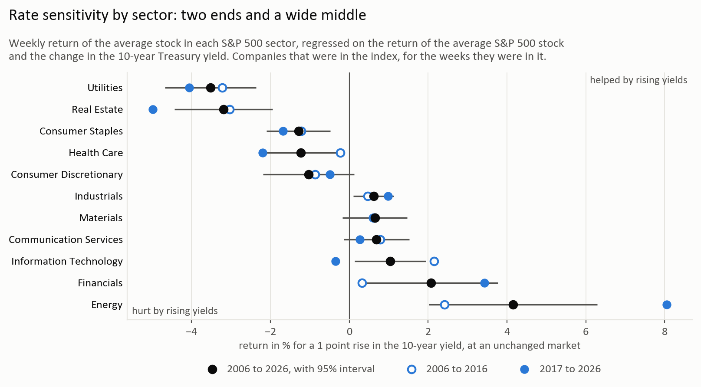
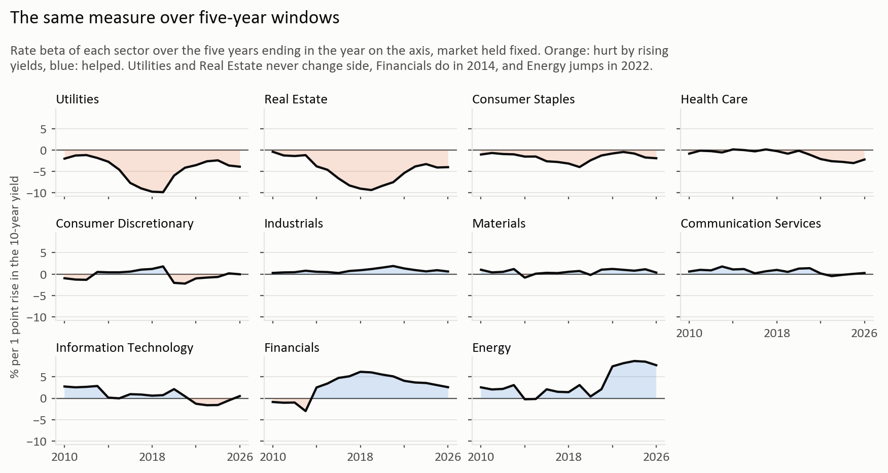

# Which sectors are rate-sensitive?

Report: [report/rate_sensitive_sectors.pdf](report/rate_sensitive_sectors.pdf)

Which S&P 500 sectors are hurt when rates rise, which are helped, and is it the same order from one decade to
the next?

The S&P 500 members from 2006 to September 2026 with a free price history, about 455 a week, each for the
weeks it was in the index. The weekly return of each sector and sub-industry is regressed on the return of the average S&P 500 stock and the change in the 10-year
Treasury yield. The number is the return in % for a 1 point rise in the yield, at an unchanged market.



## What comes out

- Two ends and a wide middle. Utilities (-3.5) and Real Estate (-3.2) are hurt by rising yields, Energy (+4.2)
  and Financials (+2.1) are helped. The seven sectors between them lie from -1.3 to +1.0 and most cannot be told
  apart.
- The hurt end is old, the helped end is young. Utilities and Real Estate are on the same side in every
  five-year window. Financials are helped only from the 2010-2014 window on, Energy mostly since 2022, and
  Technology went from +2.2 in 2006-2016 to negative in the windows that end in 2022 to 2025.
- The order does not depend on how it is measured. The 2-year yield gives the same sector order as the 10-year
  (rank correlation 0.96). Daily, four-week and 13-week returns give the same order as weekly ones (0.89, 0.95,
  0.92), with larger numbers the longer the return.
- Energy reacts to expected inflation and not to real yields: +14.8 for a 1 point rise in expected inflation
  (t = 5.1) and nothing for the real yield. Financials react to the 2-year yield and not to the slope of the curve.
- Sub-industries spread as wide inside a sector as the sectors do between them. Gold (-8.8) and homebuilders
  (-5.8) react like utilities, hotel REITs (+0.7) do not react like REITs, and in Financials it is the banks and
  investment banks (+3.0 to +5.4), not the insurance brokers, payment companies and exchanges.
- An order by sign and size, from most hurt to most helped, holds between 2006-2016 and 2017-2026: rank
  correlation 0.78 for sectors, 0.47 for sub-industries. An order by size alone does not: 0.34 and 0.25.
- An order made on 2006-2016 sorts the sub-industries of 2017-2026 with a rank correlation of 0.44 when only the
  sector is used, 0.46 with the sub-industries sorted inside their sector, and 0.53 with all sub-industries on
  one axis. Most of what holds is in the sector.
- The longest window is the best guess of what comes next. Betas on all data since 2006 miss the betas of the
  following five years by 2.4 points for sectors, betas on the last 3, 5 or 10 years by 2.7 to 2.9, and the long
  window gets the sign right in 88% of the cases against 77 to 81%.



The market itself changed sign: the average stock gained 6.3% for a 1 point rise in the 10-year in 2006-2016 and
lost 4.2% over the last five years (2022-2026). That is why every sector is measured with the market held fixed.

## Run it

The prices are not built here. They come from
[insider-trade-worth](https://github.com/Viktorsadowski/insider-trade-worth): run its ingest.py and prices.py and
events.py first. If the two repos sit next to each other nothing has to be set, otherwise PRICE_DIR in .env
points at its data folder.

```
pip install -r requirements.txt
copy .env.example .env            # your name + email for the SEC
python src/yields.py              # treasury.gov yield curves -> data/yields.csv
python src/classes.py             # a sector for every company -> data/classes.csv
python src/analysis.py            # data/results.csv, data/order.csv, data/windows.csv + figures/
python report/build_report.py     # report/rate_sensitive_sectors.pdf
```

classes.py asks the SEC for about 800 SIC codes the first time, that takes 5 to 10 minutes. Everything in data/ is
rebuilt by the scripts and is not in git, except data/manual.

## How it is measured

- A stock counts in the weeks it was an S&P 500 member (point-in-time members, fja05680/sp500), and only in the
  years where its price series is the company's own (price_map.csv from the insider project).
- Weeks end on Wednesday. A sector is the equal-weighted average of its stocks, the market is the equal-weighted
  average of all members.
- Rate beta: the coefficient on the weekly change in the yield, in a regression of the bucket's return on the
  market's return and that change. Newey-West standard errors with four lags.
- Rates: the 10-year yield is the main one. Also the 2-year, the 3-month bill, the 10-year real yield and the
  10-year breakeven. Two at a time for the 2-year with the slope and for the real yield with the breakeven
  (data/two_rates.csv).
- Sectors: today's members have GICS sector and sub-industry on a public list. The companies that left get a
  sector from their SIC code at the SEC through data/manual/sic_sectors.csv, 17 by hand
  (data/manual/sector_by_hand.csv). On today's members the SIC table gives the right sector for 89%.
- Sub-industries are today's members only. For an order each sub-industry beta is pulled toward its sector's,
  more the less precisely it is measured (data/order.csv has both, and the place in a nested and a flat order).
- Checks on the sector order: SPY as the market, without 2008, 2009 and 2020, today's members only, and
  returns over a day, four weeks and 13 weeks (the longer ones overlap, so their standard errors get more
  lags). All in data/results.csv, column spec.
- Window test: at the end of every year from 2015 to 2021 the betas are estimated on the last 3, 5 and 10 years
  and on everything since 2006, and compared with the betas of the following three and five years
  (data/windows.csv).

## Limits

- About one in nine of the companies that left has the wrong sector. Companies with no free price history are
  missing, among them the banks that failed in 2008.
- Sub-industries are thin: 23 of 121 have one stock today, 36 have five or more. Today's GICS classes are used
  for all years.
- One straight line per bucket: a rise and a fall in yields count the same. Equal weights, so a sector is its
  average company and not its largest.
- The beta is against the average stock. A sector at zero still falls when the whole market falls on a rise in
  yields.

## Files

```
src/config.py         paths, urls, the split year, colours
src/yields.py         treasury.gov -> data/yields.csv
src/classes.py        sector and sub-industry for every company
src/analysis.py       weekly returns, regressions, tables and charts
report/build_report.py
data/manual/          sic_sectors.csv, sector_by_hand.csv
```

Data: treasury.gov, SEC, github.com/fja05680/sp500, github.com/datasets/s-and-p-500-companies,
Yahoo Finance, Tiingo.
